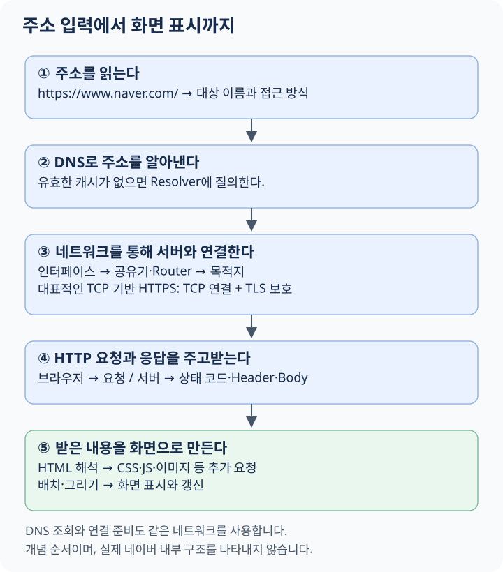

# 네트워크 입문: www.naver.com을 입력하면 일어나는 일

브라우저 주소창에 `www.naver.com`을 입력하면 잠시 뒤 페이지가 나타납니다. 그 짧은 시간 동안 내 컴퓨터는 **이름으로 주소를 찾고, 다른 네트워크로 연결하고, 서버와 데이터를 주고받고, 받은 내용을 화면으로 바꿉니다.**

이 페이지에서는 그 과정을 따라가며 네트워크의 기본 개념을 배웁니다. Kubernetes나 Docker를 먼저 알 필요는 없습니다. 각 단계에서 “이 일을 하려면 무엇이 필요할까?”를 생각해 보세요.

네이버 주소는 익숙한 출발점으로 사용합니다. 실제 네이버 내부 구성이나 현재 IP를 조사한 문서는 아닙니다. 여기서는 집의 Wi-Fi에 연결된 PC가 IPv4와 TCP 기반 HTTPS로 접속하는 대표적인 흐름을 설명합니다. HTTP 버전, 캐시, 기존 연결에 따른 차이는 뒤에서 구분합니다.

## 먼저 전체 여행을 그려 보기

**먼저 예상해 보기:** DNS로 IP를 알아내면 화면에 바로 페이지가 보일까요?

<figure class="learning-diagram" markdown="1">
<div class="diagram-scroll" tabindex="0" role="region" aria-label="가로로 스크롤할 수 있는 학습 그림" markdown="1">

[](../../assets/diagrams/web-journey.svg)

</div>
<figcaption>웹 접속의 큰 흐름입니다. 각 단계의 상세 설명은 아래에서 이어집니다. 그림을 누르면 원본을 크게 볼 수 있습니다.</figcaption>
</figure>

<details class="learning-check">
<summary>생각한 뒤 해설 보기</summary>
<p>아직 아닙니다. DNS는 연결할 주소를 알아내는 과정입니다. 서버와 통신을 준비하고 HTTP 응답을 받은 뒤, 브라우저가 HTML을 해석하고 필요한 자원을 더 가져와 화면을 만들어야 합니다.</p>
</details>

이 그림은 이해를 위한 순서입니다. 실제로는 DNS 조회도 네트워크를 사용하고, TCP 연결 준비도 Packet을 전송하는 과정입니다. “길을 먼저 다녀온 다음에 연결한다”는 뜻은 아닙니다. 한 과정을 확대해서 여러 관점으로 보는 것입니다.

## 1. 브라우저는 무엇을 하려고 할까?

내 PC 안에 네이버의 모든 페이지가 저장되어 있는 것은 아닙니다. 브라우저는 필요한 내용을 다른 곳에 요청해야 합니다.

요청하는 쪽을 **Client**, 요청을 받아 응답하는 쪽을 **Server**라고 부릅니다. 이 말은 컴퓨터의 크기보다 프로그램의 역할을 설명합니다. 한 컴퓨터에서 Client 프로그램과 Server 프로그램이 동시에 실행될 수도 있습니다.

```text
내 브라우저: 페이지를 보내 주세요
                    ↓ 요청
웹 서비스를 제공하는 프로그램
                    ↓ 응답
내 브라우저: 받은 내용을 표시
```

이 통신을 가능하게 하는 연결 기반이 **네트워크**입니다. **인터넷**은 여러 네트워크를 연결한 구조이고, **웹(Web)**은 그 위에서 HTTP 등을 사용해 문서와 자원을 제공하는 서비스입니다. 인터넷에서는 웹뿐 아니라 메일, 원격 접속 등도 이루어집니다. [MDN: 인터넷의 동작](https://developer.mozilla.org/en-US/docs/Learn_web_development/Howto/Web_mechanics/How_does_the_Internet_work)

## 2. 입력한 주소를 나누어 읽는다: URL

사용자는 `www.naver.com`만 입력했지만 브라우저는 이를 주소로 판단하고 접속 방식을 결정합니다. 여기서는 `https://www.naver.com/`에 접속한다고 가정하겠습니다. 생략한 Scheme의 처리나 HTTPS 전환은 브라우저 정책과 저장된 정보 등에 따라 달라질 수 있습니다.

```text
https://www.naver.com:443/
  │          │        │ └── Path: 요청할 자원의 경로
  │          │        └──── Port: 연결할 통신 창구
  │          └───────────── Host: 접속할 대상 이름
  └──────────────────────── Scheme: 접근 방식
```

이처럼 자원의 위치와 접근 방법을 나타내는 주소가 **URL**입니다. HTTPS의 기본 포트인 443은 보통 주소창에서 생략합니다.

`www`는 특별한 네트워크 명령어가 아니라 이름의 일부입니다. 모든 웹 주소가 www로 시작해야 하는 것은 아닙니다. `/`는 서버 파일시스템의 루트 디렉터리를 직접 열라는 뜻도 아닙니다. 서버가 이 경로를 어떻게 처리할지 결정합니다.

검색 주소처럼 `?q=network`가 붙으면 Query라는 추가 정보이고, `#section`은 Fragment입니다. Fragment는 보통 브라우저가 문서 안의 위치 등을 가리키는 데 쓰며 HTTP 요청 대상에는 포함되지 않습니다.

이제 브라우저는 이름을 알았습니다. 하지만 네트워크에서 그 이름을 그대로 목적지 IP로 사용할 수는 없습니다.

## 3. 이름에 해당하는 주소를 찾는다: DNS

**도메인 이름**은 사람이 기억하기 좋은 이름입니다. **IP 주소**는 IP 네트워크에서 데이터를 전달할 때 사용하는 주소입니다. **DNS**는 도메인 이름을 IP 주소 등의 정보와 연결하는 분산 시스템입니다.

```text
브라우저가 아는 것: www.naver.com
필요한 것:         연결할 서버의 IP 주소
```

브라우저나 운영체제에 유효한 결과가 저장되어 있을 수 있습니다. 이렇게 이전 결과를 보관해 다시 쓰는 것을 **캐시(Cache)**라고 합니다. 로컬 hosts 설정을 사용할 수도 있습니다. 필요한 결과가 없다면 설정된 DNS Resolver에 질의합니다.

**Resolver**는 필요한 DNS 답을 찾아 주는 역할입니다. 캐시가 없다면 개념적으로 다음 순서의 안내를 따라 권한 있는 서버에 도달할 수 있습니다.

```text
내 PC -> Resolver
          ├── Root: .com을 어디에 물어볼지 안내
          ├── .com 담당: naver.com을 어디에 물어볼지 안내
          └── 해당 도메인의 권한 서버: 필요한 Record 응답
```

브라우저가 매번 이 서버들을 하나씩 직접 찾아간다는 뜻은 아닙니다. 캐시와 위임된 조회가 많은 단계를 줄입니다. IPv4 주소를 나타내는 Record는 A, IPv6 주소는 AAAA이며, 다른 이름을 가리키는 CNAME 등을 거칠 수도 있습니다. 이름 하나에 여러 IP가 연결될 수도 있습니다. [MDN: 도메인 이름과 DNS](https://developer.mozilla.org/en-US/docs/Learn_web_development/Howto/Web_mechanics/What_is_a_domain_name)

DNS는 웹 페이지를 대신 가져오는 서버가 아닙니다. 주소를 얻은 뒤 실제 웹 접속은 그 주소를 향해 진행합니다.

> DNS도 데이터를 주고받아야 합니다. 이제부터 살펴볼 인터페이스와 경로는 DNS 질의를 보낼 때도 사용됩니다.

## 4. 내 PC는 어디로 데이터를 내보낼까? 인터페이스

주소를 알아냈다고 컴퓨터 밖으로 데이터가 저절로 나가는 것은 아닙니다. 보내고 받을 연결 지점이 필요합니다. 운영체제가 네트워크 통신에 사용하는 연결 지점이 **네트워크 인터페이스(Network Interface)**입니다.

노트북은 Wi-Fi로 연결할 수도 있고 랜선을 연결할 수도 있습니다. 운영체제는 이 연결들을 구분해서 다룹니다.

```text
브라우저
    ↓
운영체제
    ├── Wi-Fi 인터페이스 -> 무선 연결
    └── 유선 인터페이스  -> 랜선 연결
```

인터페이스라는 말 자체는 두 대상이 만나는 경계를 뜻합니다. 여기서는 네트워크 연결을 가리킵니다. 실제 장치에 연결된 인터페이스도 있고, 소프트웨어가 만든 가상 인터페이스도 있습니다.

`en0`, `eth0`, `enp0s8` 같은 표시는 환경별 인터페이스 이름의 예입니다. 이름 자체가 IP 주소는 아닙니다.

**인터페이스는 “어느 연결 지점을 사용할까”, IP는 “어떤 주소로 통신할까”에 답합니다.**

## 5. 목적지 주소뿐 아니라 내 주소도 필요하다

서버가 응답하려면 출발한 쪽으로 돌아올 수 있어야 합니다. 내 PC의 인터페이스에도 IP 주소가 설정되어 있습니다.

집에서는 **DHCP**라는 프로토콜을 통해 IP, Subnet 정보, Gateway, DNS 서버 정보 등을 자동으로 받는 경우가 흔합니다. 직접 고정 주소를 설정할 수도 있습니다.

```text
내 PC의 설정 예시
IP:              192.168.0.10
Subnet:          192.168.0.0/24
Default Gateway: 192.168.0.1
```

여기서 주소는 설명용입니다. 독자의 실제 주소와 같을 필요는 없습니다. 한 컴퓨터에 인터페이스가 여러 개면 서로 다른 IP를 가질 수 있고, 한 인터페이스에 여러 IP를 설정할 수도 있습니다.

### 사설 IP와 공인 IP

`192.168.0.10`은 내부 네트워크에서 사용하는 **사설 IP**입니다. 사설 IPv4 범위에는 `10.0.0.0/8`, `172.16.0.0/12`, `192.168.0.0/16`이 있습니다. 서로 분리된 집과 회사에서 같은 주소를 재사용할 수 있습니다. [RFC 1918: 사설 주소 범위](https://www.rfc-editor.org/rfc/rfc1918)

**공인 IP**는 인터넷에서 전역적으로 사용할 주소입니다. 사설 IP와 공인 IP의 관계는 잠시 뒤 NAT에서 연결합니다. “사설 IP니까 안전하다” 또는 “공인 IP니까 어떤 서비스든 접속된다”는 뜻은 아닙니다.

## 6. 목적지가 같은 동네일까? Subnet과 Gateway

운영체제는 데이터를 어느 방향으로 내보낼지 정해야 합니다. 먼저 주소의 네트워크 범위를 이해해 봅시다.

IPv4 주소는 32비트이며, 비트는 0 또는 1 하나입니다. `192.168.0.10/24`의 `/24`는 앞의 24비트를 네트워크 부분으로 사용한다는 뜻입니다. 이 예에서는 앞의 숫자 세 개가 그 부분에 해당합니다.

```text
192.168.0 | .10
네트워크 부분 | 그 안의 주소 부분
```

이 주소 범위를 **Subnet**이라고 부릅니다. `/24`를 Subnet Mask 형태로 쓰면 `255.255.255.0`입니다. `/16`, `/20`처럼 다른 길이도 있으므로 항상 앞의 숫자 세 개로 나누는 것은 아닙니다.

설명용 PC에서는 같은 `192.168.0.0/24`의 대상은 로컬 네트워크로 직접 전달할 수 있습니다. 인터넷의 서버처럼 다른 네트워크로 갈 때는 보통 **Gateway**를 거칩니다. Gateway는 다음으로 전달할 Router의 주소입니다.

**Routing Table**은 목적지별로 어느 인터페이스와 다음 경유지를 사용할지 적어 둔 경로 목록입니다. 더 구체적으로 맞는 경로가 없으면 기본 경로, 즉 Default Route를 사용합니다.

```text
집 안의 같은 Subnet 대상 -> 해당 로컬 인터페이스
그 밖의 목적지          -> 기본 경로의 Gateway
```

주소상 같은 Subnet이라는 것만으로 실제 연결이 보장되지는 않습니다. 장치들이 같은 네트워크에 연결되어 있고 주소 중복 등의 문제가 없어야 합니다.

## 7. 집 안에서 공유기까지: Switch, MAC, ARP

**Switch**는 로컬 네트워크의 장치들을 연결하고 데이터를 전달합니다. **Router**는 서로 다른 IP 네트워크 사이로 데이터를 전달합니다. 집의 공유기는 Router, Switch, Wi-Fi 접속 기능 등을 함께 제공할 수 있습니다.

목적지가 인터넷의 서버이면 내 PC가 먼저 전달할 대상은 보통 Gateway입니다. Ethernet 계열의 로컬 전달에서는 **MAC 주소**로 다음 수신자를 구분합니다. IPv4의 **ARP**는 같은 로컬 네트워크에서 IP에 해당하는 MAC 주소를 알아내는 데 사용합니다.

```text
최종 IP 목적지: 웹 서버
지금 로컬에서 전달할 대상: Gateway
```

먼 서버의 MAC을 집 안에서 직접 찾는 것이 아닙니다. MAC을 이용한 로컬 전달 대상과 IP의 최종 목적지는 다를 수 있습니다. 이미 알아낸 MAC 정보가 캐시에 있으면 다시 물어보는 과정이 줄어듭니다.

이 세부 과정은 처음에는 “다음 전달 대상도 찾아야 한다” 정도로 이해하고 넘어가도 됩니다.

## 8. 데이터는 어떤 모습으로 이동할까? Packet과 계층

프로그램의 데이터를 네트워크에서 전달할 때는 주소와 제어 정보가 필요합니다. IP에서 다루는 전송 단위를 **Packet**이라고 부릅니다.

아직 HTTP 요청을 보내기 전에도 DNS 질의, TCP 연결 설정 메시지 등이 이런 네트워크 전송을 사용합니다. 이후 페이지 응답도 여러 단위로 나뉘어 전달될 수 있습니다.

```text
전달할 데이터
    + TCP의 포트·순서 관련 정보
    + IP의 출발지·목적지 정보
    + 로컬 연결의 전달 정보
    -> 실제 신호로 전송
```

각 단계의 정보를 덧붙이는 것을 **캡슐화(Encapsulation)**라고 합니다. 받는 쪽은 각 단계의 정보를 해석해서 최종적으로 프로그램에 데이터를 전달합니다. 실제 명칭은 TCP Segment, IP Packet, 링크 계층 Frame처럼 구분하지만, 처음에는 각 정보가 어떤 문제를 해결하는지에 집중하세요.

## 9. 집 밖으로 나가기: NAT와 ISP

**ISP**는 인터넷 연결을 제공하는 통신 사업자입니다. 흔한 가정용 IPv4 환경에서 공유기는 PC의 사설 주소로 시작한 연결을 외부에서 사용할 주소·포트로 바꾸고 그 관계를 기억합니다. 이것이 널리 사용하는 NAT 구성입니다.

```text
내 PC의 사설 주소·포트
    -> 공유기에서 외부 주소·포트로 변환
    -> ISP와 인터넷
```

응답이 돌아오면 공유기는 기억한 관계를 바탕으로 내부의 해당 연결에 전달합니다. **NAT는 주소 변환**, **방화벽은 허용·차단 정책**이라는 역할을 구분하세요.

이 흐름은 흔한 예시입니다. 통신사 쪽에서 NAT를 한 번 더 하거나, IPv6로 다른 주소 구성을 사용하는 환경도 있습니다. 인터넷의 모든 연결이 NAT를 필수로 거치는 것은 아닙니다.

밖으로 시작한 연결의 응답을 받을 수 있다는 사실과, 외부에서 내부 PC로 새 연결을 시작할 수 있다는 사실은 다릅니다. 이 차이는 다음 페이지에서 Port Forwarding으로 이어집니다.

## 10. 여러 Router를 지나 서버 쪽으로

공유기가 웹 서버와 전용 선 하나로 연결되어 있는 것은 아닙니다. 인터넷에서는 여러 네트워크와 Router를 거쳐 목적지 네트워크로 전달됩니다.

```text
내 PC -> 집의 공유기 -> ISP의 네트워크
     -> 다른 네트워크와 Router들 -> 서버 측 네트워크
```

Router는 목적지 IP와 자신이 가진 경로 정보를 바탕으로 다음 방향을 고릅니다. 모든 Router가 웹 페이지의 의미를 읽고 다음 길을 정하는 것은 아닙니다.

응답이 반드시 동일한 Router들을 역순으로 통과하는 것도 아닙니다. 또한 목적지 IP가 실제 앱 프로세스를 실행하는 서버 한 대를 직접 가리킨다고 단정할 수도 없습니다. 앞에서 트래픽을 받는 장치나 Proxy가 있을 수 있습니다.

**Latency**는 전달과 응답에 걸리는 지연이고, **Bandwidth**는 일정 시간에 전달할 수 있는 양과 관련됩니다. 대역폭이 커도 왕복 지연이 사라지는 것은 아닙니다. 페이지가 느릴 때는 서버 처리 시간도 함께 생각해야 합니다.

## 11. 도착한 곳에서 어떤 프로그램을 찾을까? Port와 Socket

서버 측에는 여러 프로그램이 함께 실행될 수 있습니다. IP만으로 어느 프로그램의 통신 창구를 사용할지 충분히 구분할 수 없습니다. TCP와 UDP의 **Port**가 그 구분에 사용됩니다.

```text
Client의 임시 포트 -> 서버 IP의 TCP 443
```

Client도 자기 쪽 포트를 사용합니다. 서로 다른 주소·포트 조합을 통해 여러 연결을 구분할 수 있으므로, 서버는 같은 443번으로 여러 Client를 받을 수 있습니다.

프로그램이 운영체제의 통신 기능을 사용하기 위한 수단을 **Socket**이라고 부릅니다. 서버는 특정 로컬 주소·포트에 Socket을 연결하고, TCP 연결을 기다립니다. 주소를 지정하는 것이 bind, 연결 대기가 listen입니다.

443은 HTTPS에서 사용하는 기본 포트입니다. 해당 번호를 쓴다고 임의의 프로그램이 자동으로 HTTPS 서버가 되지는 않습니다. 방화벽에서 443을 허용했다고 서버 프로그램이 실행되는 것도 아닙니다.

## 12. 통신을 준비한다: TCP

IP는 Packet의 도착과 순서를 자체적으로 보장하지 않습니다. TCP는 그 위에서 **순서 있는 바이트 흐름**을 제공하며, 손실된 데이터의 재전송 등을 처리합니다.

새 TCP 연결의 기본 설정 과정을 Three-way Handshake라고 부릅니다.

```text
Client -> Server: SYN
Client <- Server: SYN + ACK
Client -> Server: ACK
```

SYN은 연결 시작 시 순서 번호를 맞추는 데, ACK는 수신 확인에 사용됩니다. 이 과정으로 연결 상태를 준비하지만 상대가 진짜 네이버인지 인증하는 것은 아닙니다. 그것은 다음 TLS 단계에서 다룹니다.

TCP도 지속적인 장애를 없앨 수는 없습니다. 복구할 수 없으면 연결이 실패합니다. 또한 TCP는 HTTP 요청의 경계를 알아서 만들어 주지 않으므로 HTTP는 메시지를 구분할 규칙이 필요합니다. [RFC 9293: TCP](https://www.rfc-editor.org/rfc/rfc9293)

## 13. 내용을 보호한다: HTTPS와 TLS

같은 길을 통과하는 다른 주체가 요청과 응답을 쉽게 읽거나 바꾸지 못하게 보호해야 합니다. HTTPS에서는 **TLS**가 통신 상대 확인, 암호화, 변조 탐지 등을 담당합니다.

브라우저는 TLS Handshake 중 전달받은 인증서의 신뢰 관계, 유효 기간, 접속할 이름과의 일치 여부 등을 검증합니다. 양쪽은 안전하게 통신할 키를 준비합니다. 이후 HTTP 데이터를 보호해 전달합니다.

```text
TCP: 바이트를 주고받을 연결
TLS: 그 연결 위의 통신 보호와 서버 인증
HTTP: 무엇을 요청하고 어떻게 응답할지의 규칙
```

인증서는 사이트의 모든 내용이 옳거나 안전하다고 보증하지 않습니다. 또한 HTTPS가 IP 같은 모든 네트워크 정보를 숨기는 것도 아닙니다.

이 문서는 TCP 위의 TLS를 설명합니다. HTTP/3는 UDP 위의 QUIC을 사용하며 연결·보호 방식이 이 그림과 다릅니다. 실제 접속이 반드시 TCP 순서 그대로 진행된다고 단정하지 마세요.

## 14. 이제 페이지를 요청한다: HTTP

통신할 준비가 되면 브라우저는 서버에 자원을 요청합니다. 아래는 구조를 이해하기 위한 HTTP/1.1 예시이며 실제 네이버 요청을 캡처한 결과는 아닙니다.

```http
GET / HTTP/1.1
Host: www.naver.com
Accept: text/html
```

| 부분 | 의미 |
|---|---|
| `GET` | 자원을 가져오려는 요청 Method |
| `/` | 요청할 Path |
| `Host` | 접속한 서버에서 원하는 대상 이름 |
| `Accept` | Client가 받을 수 있는 표현 형식에 대한 정보 |

**Header**는 요청이나 응답을 설명하는 정보이고, **Body**는 전달할 본문입니다. 예를 들어 폼 데이터를 전송하는 요청에는 Body가 들어갈 수 있습니다.

DNS와 Host는 다른 단계의 질문에 답합니다. DNS는 “어느 주소로 연결할까”, Host는 “연결한 곳에서 어떤 이름의 사이트를 원할까”입니다. HTTP/2·3에서는 이 의미가 `:authority` 같은 필드로 표현됩니다.

TLS에서는 HTTP보다 먼저 서버 이름을 알리는 SNI가 사용될 수도 있습니다. 따라서 HTTPS에서 단순히 IP로 접속하고 Host만 바꾸면 이름 기반 HTTPS 접속과 완전히 같다고 볼 수는 없습니다.

## 15. 서버에서는 무슨 일이 일어날까?

요청을 받은 프로그램은 정적 파일을 보내거나, 앱을 실행해 데이터를 조회하고 응답을 만들 수 있습니다. 서버 한 프로그램이 모두 수행할 수도 있고 여러 구성요소가 나누어 처리할 수도 있습니다.

```text
Client -> 앞에서 요청을 받는 구성요소 -> 앱 -> 필요한 데이터
```

**Reverse Proxy**는 서버 측에서 요청을 받아 내부 대상에 전달합니다. **Load Balancer**는 여러 처리 대상에 연결이나 요청을 분산합니다. **CDN**은 여러 위치의 서버를 통해 콘텐츠를 전달하고 캐시 등으로 원래 서버까지의 요청을 줄일 수 있습니다.

이것들은 대규모 웹 서비스를 이해하는 데 유용한 개념입니다. 위 순서대로 네이버 내부가 구성되어 있다는 뜻은 아닙니다. DNS가 알려 준 IP가 페이지를 만드는 마지막 앱의 주소일 필요는 없다는 점을 기억하세요.

## 16. 응답을 받는다: 상태 코드와 본문

설명용 HTTP/1.1 응답은 다음처럼 생겼습니다. 실제 서버에서는 본문의 길이나 전달 방식을 나타내는 정보 등도 함께 사용합니다.

```http
HTTP/1.1 200 OK
Content-Type: text/html; charset=utf-8

<!doctype html>
<html>...</html>
```

**상태 코드**는 요청 처리 결과를 나타냅니다. 200은 성공 응답의 한 예이고, 3xx는 다른 위치로 이동하거나 캐시를 검증하는 상황 등에 쓰이며, 4xx·5xx는 각각 Client 요청 또는 서버 처리 측 문제를 나타냅니다. 모든 오류가 “인터넷 연결 실패”인 것은 아닙니다.

응답 데이터는 보호된 연결과 네트워크를 통해 돌아옵니다. 이때 요청과 응답 전체가 각각 IP Packet 하나에 담기는 것은 아닙니다. **HTTP 메시지와 네트워크 전송 단위는 다릅니다.** 요청·응답 구조는 [MDN HTTP 개요](https://developer.mozilla.org/en-US/docs/Web/HTTP/Guides/Overview)에서 더 확인할 수 있습니다.

## 17. HTML을 받으면 화면이 완성될까?

HTML은 화면의 사진이 아니라 문서 구조를 설명하는 데이터입니다. 브라우저는 이를 읽어 **DOM**이라는 문서 구조를 만들고, CSS로 스타일을 계산하며, 배치와 그리기를 수행합니다. JavaScript는 동작을 실행하고 문서나 데이터를 바꿀 수 있습니다.

HTML을 읽다가 CSS, JavaScript, 이미지, 글꼴 주소를 발견하면 추가로 가져와야 할 수 있습니다. JavaScript 실행 후 새로운 데이터 요청이 발생하기도 합니다.

```text
첫 HTML 응답
    ├── CSS 요청
    ├── JavaScript 요청 -> 실행 후 추가 API 요청 가능
    ├── 이미지 요청
    └── 글꼴 요청
```

같은 서버의 기존 연결을 재사용할 수도 있고, 다른 도메인의 자원이라면 별도의 이름 해석과 연결이 필요할 수도 있습니다. 모든 자원을 다 받은 뒤에만 처음 화면을 표시하는 것도 아닙니다. 준비된 내용부터 그리며 갱신할 수 있습니다. [MDN: 브라우저가 페이지를 표시하는 과정](https://developer.mozilla.org/en-US/docs/Web/Performance/Guides/How_browsers_work)

**주소 입력 한 번은 HTTP 요청 한 번과 같지 않습니다.**

## 18. 다시 접속하면 왜 과정이 달라질까?

앞에서는 처음 접속하는 대표적인 흐름을 따라갔습니다. 실제로는 다음 정보가 재사용될 수 있습니다.

| 저장하거나 재사용하는 것 | 줄어들 수 있는 과정 |
|---|---|
| DNS 결과 | 이름에 해당하는 주소를 다시 찾는 과정 |
| ARP 정보 | 로컬 다음 전달 대상의 MAC 조회 |
| 기존 연결 | TCP와 TLS 연결 준비 |
| HTTP 응답 캐시 | 자원을 다시 전송받는 양 또는 요청 자체 |

캐시는 영원히 같은 결과를 사용한다는 뜻은 아닙니다. 유효 기간과 재검증 규칙이 있습니다. 또한 HTTP/2는 하나의 TCP 연결로 여러 요청 흐름을 처리할 수 있고, HTTP/3는 QUIC을 사용합니다.

**UDP**는 TCP와 달리 Datagram 단위를 전달하며 자체적으로 전달·순서를 보장하지 않습니다. 그 위에서 QUIC처럼 필요한 신뢰성과 보안 기능을 구현할 수 있으므로, “UDP를 쓰면 신뢰성 있는 웹 통신은 불가능하다”는 결론은 틀립니다.

## 19. 배운 용어를 한 장의 지도로 묶기

| 관점 | 개념 | 답하는 질문 |
|---|---|---|
| 이름과 자원 | URL, DNS | 무엇을 찾으며 어느 주소로 갈까? |
| 로컬 연결 | Interface, MAC, ARP, Switch | 내 환경에서 어디로 내보내고 누구에게 먼저 줄까? |
| 네트워크 간 전달 | IP, Subnet, Router, Gateway, NAT | 다른 네트워크의 목적지까지 어떻게 갈까? |
| 프로그램 간 통신 | Port, Socket, TCP·UDP | 어느 통신 창구에 어떤 방식으로 전달할까? |
| 보호와 의미 | TLS, HTTP | 어떻게 보호하고 무엇을 요청할까? |
| 화면 표시 | HTML, CSS, JavaScript, Rendering | 받은 데이터를 어떻게 화면으로 바꿀까? |

이 역할 분담을 **계층**이라고 부릅니다. TCP/IP 모델이나 OSI 모델은 이런 역할을 묶어 설명하는 틀입니다. 처음부터 계층 번호를 외우기보다, 위 요청에서 각 역할이 왜 필요한지 먼저 설명해 보세요.

## 20. 연결이 실패하면 어느 단계일까?

```text
이름을 주소로 바꿀 수 없음 -> DNS와 이름 설정
목적지까지 도달하지 못함 -> 인터페이스·경로·방화벽 등
연결 거부              -> 프로그램 리스닝 또는 중간 장치의 거부 등
인증서 오류            -> TLS의 이름·신뢰·유효 기간 등
HTTP 오류 응답         -> 이미 HTTP 처리 단계까지 도달한 단서
화면 일부만 안 보임     -> 추가 자원·스크립트·앱 동작 등을 확인
```

증상은 단서이며 원인을 하나로 확정하지는 않습니다. 예를 들어 `ping`은 ICMP라는 별도 프로토콜을 확인하므로, 성공했다고 HTTPS도 정상이라는 뜻은 아닙니다.

원한다면 브라우저 개발자 도구의 Network 탭을 열고 새로고침하여 첫 Document와 뒤따르는 자원 요청을 관찰해 보세요. 이 탭이 ARP나 모든 TCP Packet을 보여 주는 것은 아닙니다. 실행하지 않아도 본문의 개념을 읽는 데는 지장이 없습니다.

## 21. 다음으로 넘어가기 전에

1. DNS 서버가 HTTP 요청을 계속 중계하는가?
2. 인터페이스의 이름과 IP 주소는 무엇이 다른가?
3. 최종 서버의 IP와 다음 Gateway는 왜 다른 대상인가?
4. IP를 알면서도 Port가 필요한 이유는 무엇인가?
5. TCP 연결과 TLS 인증은 각각 무엇을 해결하는가?
6. 같은 IP에서 여러 사이트를 제공할 수 있는 이유는 무엇인가?
7. HTML을 받았는데도 요청이 계속 발생하는 이유는 무엇인가?

이제 목적지를 바꾸어 봅시다. 인터넷의 웹 서버 대신 **내 PC 안의 VM이나 Container에서 실행하는 앱**이라면 어떤 부분이 같고 어떤 부분이 달라질까요?

다음: [VM·Docker로 이어지는 네트워크](foundations.md)
