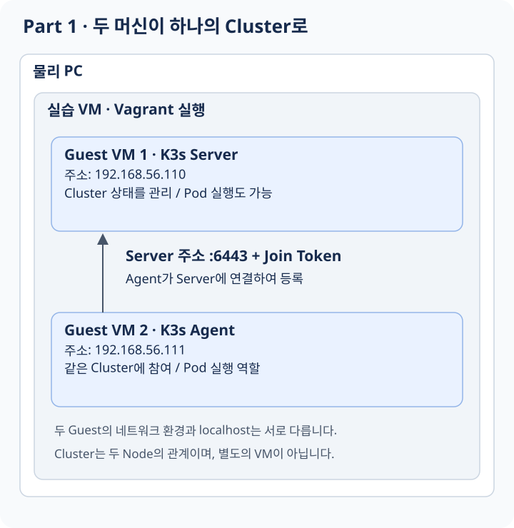

# Part 1: 여러 머신을 하나의 Cluster로 이해하기

이번 Part의 질문은 **“서로 다른 두 컴퓨터를 어떻게 하나의 시스템으로 관리할까?”**입니다. [네트워크 입문](network-journey.md)과 [VM·Docker의 네트워크](foundations.md)에서 배운 인터페이스, IP, Port를 VM 두 대에 적용해 봅니다.

## 이 과제의 요구사항으로 무엇을 배울까?

과제는 **Vagrant로 VM 두 대를 만들고, 고정 IP와 SSH를 준비한 뒤 K3s Server와 Agent로 연결하라**고 요구합니다. 먼저 어떤 위치 관계가 생기는지 봅시다.

**먼저 예상해 보기:** 두 VM이 같은 PC 안에 있으니 Agent에서 localhost로 Server에 접속해도 될까요?

<figure class="learning-diagram" markdown="1">
<div class="diagram-scroll" tabindex="0" role="region" aria-label="가로로 스크롤할 수 있는 학습 그림" markdown="1">

[](../../assets/diagrams/part1-cluster.svg)

</div>
<figcaption>바깥 상자는 실행 환경, 위쪽 화살표는 Agent의 등록 연결을 뜻합니다. 그림을 누르면 원본을 크게 볼 수 있습니다.</figcaption>
</figure>

<details class="learning-check">
<summary>생각한 뒤 해설 보기</summary>
<p>아니요. 두 Guest는 별도의 네트워크 환경을 가집니다. Agent의 localhost는 Agent 자신입니다. Server의 IP로 가는 경로가 있어야 하며, 주소로 연결한 뒤에는 Token으로 참여 자격도 확인해야 합니다.</p>
</details>

| 요구사항 | 이 요구를 통해 배우는 것 |
|---|---|
| VM 두 대 만들기 | 하나의 PC 안에서도 독립된 운영체제 환경을 여러 개 구성할 수 있다 |
| Vagrant 사용 | 환경을 수동 설정이 아닌 재현 가능한 정의로 관리할 수 있다 |
| 서로 다른 고정 IP | 머신이 서로 찾아가려면 실제 연결과 주소가 필요하다 |
| 비밀번호 없는 SSH | 원격 접속과 인증은 별개의 개념이며 키로 자격을 증명할 수 있다 |
| Server / Agent 연결 | 독립된 머신들이 역할을 나누어 하나의 관리 시스템에 참여할 수 있다 |

이 Part를 읽고 나면 **“내 PC 안에 만든 두 VM이 왜 별도의 머신이며, 어떻게 하나의 Cluster가 되는지”** 설명할 수 있는 것이 목표입니다. 아래에서는 각 요구가 필요로 하는 개념을 하나씩 풉니다.

## 1. 먼저 왜 VM이 필요한가?

Kubernetes가 여러 머신을 관리하는 모습을 보려면 독립적으로 실행되는 환경이 필요합니다. 물리 컴퓨터를 여러 대 준비하는 대신 VM으로 각각의 운영체제와 프로세스를 가진 환경을 만듭니다.

```text
실습 환경
├── Server VM: 자신의 OS, 프로세스, 인터페이스와 IP
└── Agent VM:  자신의 OS, 프로세스, 인터페이스와 IP
```

같은 물리 컴퓨터 위에 있어도 두 VM은 같은 운영체제 안의 프로그램 두 개와는 다릅니다. 서로 통신하려면 네트워크 연결이 필요합니다. Server VM의 localhost로 Agent VM을 찾을 수 없는 이유입니다.

과제 PDF v4.0은 전체 작업을 VM에서 하도록 요구합니다. 따라서 물리 컴퓨터, 작업을 진행할 실습 VM, Vagrant가 만드는 Guest VM을 구분해야 합니다. 여기서는 먼저 두 Guest 사이의 관계에 집중합니다.

## 2. Vagrant는 어떤 문제를 해결할까?

VM을 수동으로 만들면 이름, 운영체제, 네트워크, 메모리를 매번 다시 설정해야 합니다. 다른 사람이 같은 환경을 만들었는지도 확인하기 어렵습니다.

**Vagrant**는 이 환경의 구성을 파일로 적고 반복해서 만들도록 도와줍니다. 환경의 설명서가 코드로 남는 셈입니다.

| 용어 | 역할 |
|---|---|
| Vagrantfile | 만들 VM의 설정을 적은 파일 |
| Box | VM의 출발점이 되는 운영체제 이미지 |
| Provider | 실제 VM을 실행하는 가상화 기반 |
| Provisioning | VM 생성 후 프로그램 설치와 초기 설정을 준비하는 과정 |

```text
Vagrantfile: 어떤 VM을 만들지 설명
    -> Provider: 가상 머신 실행
    -> Provisioning: VM 안에 필요한 환경 준비
```

Vagrant가 VM을 만들었다고 Kubernetes Cluster가 생기는 것은 아닙니다. 아직은 독립된 컴퓨터들이 준비된 단계입니다.

## 3. 독립된 컴퓨터에서 Node와 Cluster로

VM에 Container를 실행할 수 있다고 가정해 봅시다. 앱을 어느 VM에 실행할지, 실행 상태를 어떻게 확인할지, 죽은 앱을 다시 만들지 누가 결정할까요?

**Kubernetes**는 앱을 어떤 상태로 유지할지 선언하고, 여러 머신에서 그 상태를 관리하는 시스템입니다. 참여하는 머신을 **Node**, 함께 관리되는 Node들의 집합을 **Cluster**라고 부릅니다.

**K3s**는 이 Kubernetes를 비교적 작은 환경에서 실행하기 쉽게 배포한 구성입니다. 별개의 새로운 Container 개념이 아니라 Kubernetes를 설치하고 운영하는 한 가지 방식입니다.

```text
VM 2대: 따로 존재하는 컴퓨터
    -> K3s 설치와 등록
    -> Node 2개: 같은 Kubernetes Cluster에 참여하는 컴퓨터
```

## 4. Server와 Agent는 무엇을 나누어 맡을까?

Cluster에는 원하는 상태를 기록하고 실제 상태와 비교하는 관리 기능이 필요합니다. 동시에 각 Node에서 Container를 실행하고 상태를 보고하는 기능도 필요합니다.

| 역할 | 질문 |
|---|---|
| K3s Server | 어떤 앱과 Node가 있어야 하며 현재 어떤 상태인가? |
| K3s Agent | 내 Node에 할당된 앱을 실행하고 상태를 어떻게 보고할까? |

Server 쪽의 관리 기능들을 **Control Plane**이라고 부릅니다. API Server는 관리 요청을 받는 창구이고, Scheduler는 새 Pod가 어느 Node에서 실행될지 결정합니다. Controller들은 원하는 상태와 실제 상태의 차이를 줄이는 일을 합니다.

Node 쪽의 **kubelet**은 Pod가 실행되도록 관리하고 상태를 보고하는 구성요소입니다. **Container Runtime**은 실제 Container를 실행합니다. K3s는 기본적으로 containerd라는 Runtime을 사용합니다.

처음에는 모든 구성요소 이름을 외우기보다 “상태를 관리하는 쪽과 실제 실행을 맡는 쪽이 협력한다”는 관계를 이해하세요. Server도 기본적으로 앱 Pod를 실행할 수 있습니다. 그래서 Part 2에서는 Server 한 대로도 Cluster와 앱을 함께 운영할 수 있습니다.

## 5. 두 Node는 어떻게 서로 찾아갈까?

과제에서 지정한 주소를 대입하면 다음과 같습니다.

```text
Server: 192.168.56.110
Agent:  192.168.56.111

Agent -> https://192.168.56.110:6443 -> Server의 API 진입점
```

각 요소를 다시 읽어 봅시다.

- `https`: 보호된 HTTP 통신을 사용합니다.
- `192.168.56.110`: 찾아갈 Server 주소입니다.
- `6443`: 그 Server에서 K3s API 연결을 받을 포트입니다.

두 VM이 같은 실습용 네트워크에 연결되고 주소와 경로가 맞아야 합니다. Server 프로그램도 해당 포트에서 연결을 받아야 합니다.

VM에 NAT용 인터페이스와 실습용 인터페이스가 함께 있다면 “인터넷 다운로드에 쓰는 주소”와 “다른 Node가 찾아올 주소”가 다를 수 있습니다. 주소가 여러 개 보일 때 아무거나 선택하면 안 되는 이유입니다.

## 6. 연결할 수 있으면 누구나 Cluster에 들어와도 될까?

주소는 목적지를 알려 주지만 접속자의 자격을 증명하지는 않습니다. 따라서 Agent가 같은 Cluster에 참여하려면 인증 정보가 필요합니다. 여기서 **Join Token**을 사용합니다.

```text
Server 준비
    -> 참여에 필요한 Token 준비
    -> Agent가 Server 주소로 연결
    -> Token을 사용해 참여 자격 확인
    -> Node로 등록되고 상태 보고
```

Server 주소는 “어디로 갈까”, Token은 “참여할 자격이 있는가”라는 서로 다른 질문에 답합니다. Token은 네트워크 연결을 만들어 주지 않습니다. 연결 경로가 없으면 올바른 Token이 있어도 등록되지 않습니다.

등록과 정상 동작도 다릅니다. 목록에 Node가 나타나도 네트워크나 Runtime이 준비되지 않으면 `NotReady`일 수 있습니다. `Ready`는 Kubernetes가 해당 Node를 실행에 사용할 준비가 된 상태로 판단한다는 중요한 신호입니다.

## 7. SSH, kubectl, kubeconfig 구분하기

SSH는 VM의 운영체제에 사용자로 접속하는 통신입니다. 터미널로 로그인해서 파일이나 프로세스를 확인할 때 사용합니다.

kubectl은 Kubernetes API에 요청을 보내는 관리 도구입니다. Agent의 터미널로 들어가서 명령을 대신 치는 도구가 아닙니다.

```text
SSH Client -> VM의 SSH 서비스 -> Linux 사용자 환경
kubectl    -> Kubernetes API  -> Cluster 상태 조회·변경
```

**kubeconfig**는 kubectl이 어느 Cluster에 어떤 인증 정보로 연결할지 알려 주는 설정입니다. **Context**는 그중 사용할 Cluster·사용자·Namespace 설정의 묶음입니다.

| 정보 | 용도 |
|---|---|
| SSH Key | Linux 사용자로 접속할 자격 증명 |
| Join Token | Agent가 Cluster에 참여할 때 사용 |
| kubeconfig | 관리 Client가 API에 연결할 주소와 인증 설정 |

비밀번호 없이 SSH 접속한다는 것은 인증을 없앤다는 뜻이 아닙니다. 키로 인증한다는 뜻입니다.

## 8. Part 1에서 완성되는 것은 무엇인가?

이 단계에서는 업무용 앱을 배포하기보다 **앱을 관리할 기반**을 만듭니다.

```text
네트워크 연결
    -> Server와 Agent 통신
    -> 인증 후 같은 Cluster에 참여
    -> Node 상태 보고
    -> 두 Node를 하나의 API로 조회·관리
```

SSH가 된다는 사실은 Linux 접속 경로를 확인한 것입니다. Cluster 등록까지 성공했다는 뜻은 아닙니다. 반대로 kubectl 연결 오류가 난다고 VM 자체가 꺼졌다고 단정할 수도 없습니다. 어떤 통신을 확인했는지 구분해야 합니다.

## 9. 과제 요구사항을 개념에 연결하기

기준: `inception_of_things.pdf` v4.0, 본문 6–8쪽.

| 요구사항 | 이해할 개념 |
|---|---|
| Vagrant로 두 VM 실행 | 환경의 반복 생성 |
| 최신 안정 배포판 | Guest 운영체제 선택 |
| 팀원 login에 `S`, `SW`를 붙인 이름 | 머신 식별 |
| `.110`, `.111`의 전용 IP | Node 간 주소와 실제 인터페이스 |
| 비밀번호 없는 SSH | 키 기반 운영체제 접속 |
| Server / Agent 모드 | Cluster 관리와 Node 실행 역할 |
| kubectl 사용 | API를 통한 관리 |

원문은 primary network interface의 지정 IP와 최소 자원 구성을 강조합니다. Provider의 NIC 배치와 설치할 K3s 버전의 자원 조건을 실제 구현 시 따로 확인해야 합니다. 자세한 조건과 예제는 [구현 참고](implementation-reference.md)에 있습니다.

## 10. 이해를 확인하기

1. Vagrant가 VM을 만들었다고 Cluster가 완성되지 않는 이유는 무엇인가?
2. Server의 IP와 포트, Join Token은 각각 무엇을 해결하는가?
3. Agent에서 localhost로 Server를 찾으면 왜 안 되는가?
4. Server도 Pod를 실행할 수 있다는 사실은 Part 2와 어떻게 연결되는가?
5. SSH는 되지만 Node가 등록되지 않았다면 어느 통신을 더 확인해야 하는가?

다음: [Part 2 — 앱의 실행과 요청 전달을 나누어 이해하기](part2.md)
