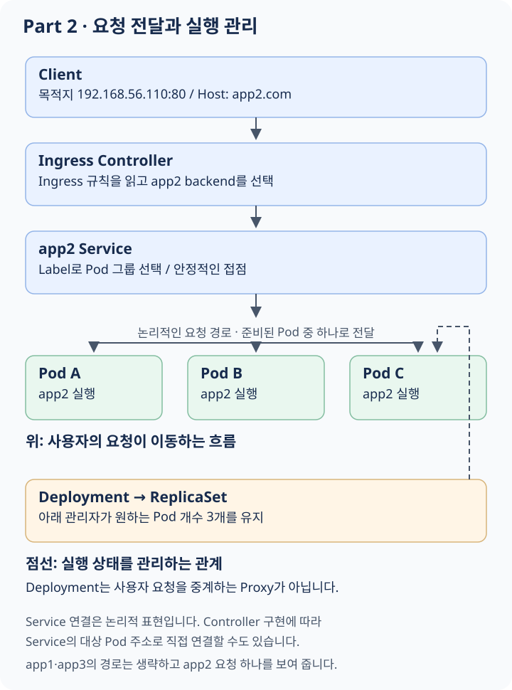

# Part 2: 앱의 실행과 요청 전달을 나누어 이해하기

이번 Part의 질문은 **“하나의 IP로 들어오는 요청을 어떻게 서로 다른 앱에 전달할까?”**입니다. 먼저 앱을 실행하는 문제와 그 앱에 접속하는 문제를 구분합니다.

## 이 과제의 요구사항으로 무엇을 배울까?

과제는 **VM 한 대의 K3s 안에 웹 앱 세 개를 배포하고, 요청의 Host에 따라 서로 다른 앱을 보여 주라**고 요구합니다. app2는 복제본 세 개가 필요합니다.

```text
내 PC
└── 실습 VM: Vagrant 실행
    └── Guest VM 1대
        └── K3s가 관리하는 환경
            ├── app1 Pod -> Container -> 앱
            ├── app2 Pod A -> Container -> 앱
            ├── app2 Pod B -> Container -> 앱
            ├── app2 Pod C -> Container -> 앱
            └── app3 Pod -> Container -> 앱
```

여기서 “Kubernetes 안에 앱이 있다”는 말은 Kubernetes가 앱을 담는 별도 OS라는 뜻이 아니라 **Pod의 실행과 상태를 관리한다**는 뜻입니다. 위 Pod 수는 이 문서에서 app1·app3를 하나씩 두는 구성 예시이며, 원문에서 복제본 수를 명시한 앱은 app2입니다.

| 요구사항 | 이 요구를 통해 배우는 것 |
|---|---|
| VM 한 대에서 앱 세 개 실행 | 머신과 앱의 실행 단위는 다르며 한 Node가 여러 Pod를 실행할 수 있다 |
| app2 복제본 세 개 | 원하는 개수를 선언하고 실제 상태를 계속 맞추는 방식을 배운다 |
| 같은 IP에서 Host별 앱 선택 | IP·Port로 접속한 뒤 HTTP 정보로 앱을 구분할 수 있다 |
| 나머지 요청은 app3 | 구체적인 규칙뿐 아니라 기본 동작도 정의해야 한다 |
| Ingress 구성 | 외부 요청과 내부 앱을 연결하는 규칙과 실행 주체를 구분한다 |

이 Part를 읽고 나면 **“PC 안의 VM에서 실행되는 앱까지 내 요청이 어떻게 들어가며, 앱 복제본은 누가 유지하는지”** 설명할 수 있는 것이 목표입니다.

## 1. 우리가 원하는 모습

과제에서는 K3s Server가 실행되는 VM 한 대에 웹 앱 세 개를 올립니다.

```text
목적지: 192.168.56.110:80
    ├── Host가 app1.com -> app1
    ├── Host가 app2.com -> app2
    └── 그 외          -> app3
```

app2는 같은 앱의 복제본 세 개를 유지해야 합니다. 여기서 두 질문이 생깁니다.

1. 앱을 어떻게 실행하고 정해진 개수를 유지할까?
2. 요청을 어떤 앱의 어느 복제본에 보낼까?

Deployment는 첫 질문에, Service와 Ingress는 두 번째 질문에 연결됩니다.

## 2. Container를 Pod에 담는 이유

Container는 앱 프로세스를 격리해서 실행하는 환경입니다. Kubernetes는 Container 하나를 직접 관리하는 대신 **Pod**라는 배포 단위를 사용합니다.

Pod에는 하나 이상의 Container가 들어갈 수 있습니다. 같은 Pod의 Container들은 네트워크 환경을 공유하고 함께 배치됩니다. 예를 들어 앱과 그 앱을 보조하는 프로그램을 가까이 두는 구성에 사용할 수 있습니다.

이 과제에서는 먼저 다음처럼 생각하면 됩니다.

```text
Pod 하나
└── 웹 앱 Container 하나
```

Pod와 Container가 같은 개념은 아니지만, 여기의 간단한 앱에서는 Pod 하나가 앱 실행 하나에 대응합니다.

## 3. Pod는 고정된 서버가 아니다

기존 서버 운영에서는 한 머신에 접속해 프로그램을 고치고 오랫동안 같은 머신을 사용한다고 생각하기 쉽습니다. Kubernetes의 Pod는 교체될 수 있는 실행 단위입니다.

```text
기존 Pod: 이름 A, IP A
    -> 종료 또는 교체
새 Pod:   이름 B, IP B
```

새 Pod가 같은 앱을 실행해도 이름과 IP가 달라질 수 있습니다. 따라서 Client가 “app2는 언제나 이 Pod IP다”라고 기억하면 문제가 생깁니다.

또한 Pod를 한 번 만들었다는 사실만으로 항상 앱 복제본 세 개가 유지되지는 않습니다. 상태를 계속 관리하는 역할이 필요합니다.

## 4. Deployment와 원하는 상태

**선언적 관리**는 실행할 동작을 매번 명령하기보다 원하는 결과를 적는 방식입니다.

```text
명령: 지금 Pod 하나를 만들어라
선언: app2 Pod가 3개 있는 상태를 유지하라
```

**Deployment**는 어떤 Pod 구성과 배포 상태를 유지할지 선언합니다. Deployment가 관리하는 **ReplicaSet**은 필요한 Pod 수가 유지되도록 합니다. Replica는 복제본을 뜻합니다.

```text
Deployment: app2, 원하는 개수 3
    -> ReplicaSet
        ├── Pod A
        ├── Pod B
        └── Pod C
```

Pod B가 삭제되면 실제 개수는 2가 됩니다. 관리 구성요소가 차이를 발견하고 새 Pod를 생성하여 원하는 개수에 맞춥니다. 이를 **Reconciliation**, 즉 원하는 상태와 실제 상태를 맞추는 과정이라고 합니다.

항상 순간적으로 정확히 세 개만 보인다는 뜻은 아닙니다. 교체 중에는 준비되지 않은 새 Pod나 종료 중인 Pod가 함께 보일 수 있습니다.

## 5. 복제본 세 개면 무엇이 좋아질까?

여러 복제본은 요청을 나누어 처리하거나 일부 Pod가 종료되었을 때 나머지가 응답하는 데 도움이 됩니다. 하지만 어떤 장애까지 견디는지는 배치에 달려 있습니다.

이 과제의 app2 Pod 세 개는 VM 한 대 위에 있습니다.

```text
VM 한 대
├── app2 Pod A
├── app2 Pod B
└── app2 Pod C
```

Pod 하나가 사라지면 다른 Pod가 남지만 VM 전체가 꺼지면 모두 영향을 받습니다. 복제본 수와 머신 장애에 대한 대비는 같은 질문이 아닙니다.

## 6. Label과 Selector: 같은 앱의 Pod를 어떻게 묶을까?

Pod 이름이 계속 바뀔 수 있다면 일정한 기준으로 그룹을 찾아야 합니다. **Label**은 리소스에 붙이는 이름표이고 **Selector**는 어떤 이름표를 가진 대상을 고를지 정한 조건입니다.

```text
Pod A: app=app2
Pod B: app=app2
Pod C: app=app2

Selector: app=app2인 Pod를 고른다
```

`app=app2`는 의미 있는 표식이지만 시스템이 알아서 추측해 붙여 주는 것은 아닙니다. 설정에서 일관되게 연결해야 합니다. 앱 이름이 app2여도 Label이 다르면 원하는 그룹으로 선택되지 않을 수 있습니다.

## 7. Service: 바뀌는 Pod 앞에 안정적인 접점 만들기

**Service**는 선택된 Pod 그룹에 접속할 안정적인 이름과 진입점을 제공합니다. 일반적인 ClusterIP Service에는 Cluster 내부에서 사용하는 가상 IP가 있습니다.

```text
Client 또는 다른 구성요소
    -> app2 Service
        ├── 준비된 Pod A
        ├── 준비된 Pod B
        └── 준비된 Pod C
```

Pod B가 교체되어도 Client가 새 IP를 직접 찾아 설정을 바꾸지 않아도 됩니다. Service의 Selector에 맞는 Pod와 준비 상태가 연결 대상에 반영됩니다. 대상 주소와 상태를 나타내는 리소스가 **EndpointSlice**입니다.

Service는 그 자체가 앱을 실행하는 프로세스나 Container는 아닙니다. Kubernetes의 네트워크 구현이 전달 규칙을 구성합니다. Ingress Controller에 따라 Service의 가상 IP를 거치거나 대상 Pod 주소를 직접 사용할 수 있습니다.

### Port와 targetPort

Service의 진입 포트와 앱이 실제로 듣는 포트는 구분합니다.

```text
Service port 80 -> Pod targetPort 8080 -> 실제 앱
```

이 예시에서는 Client가 80으로 접속해도 앱은 8080에서 실행됩니다. 두 숫자가 같아야 하는 것은 아닙니다. `containerPort` 선언만으로 프로그램이 실행되거나 포트가 외부에 공개되는 것도 아닙니다.

Service의 주소와 연결 대상 개념은 [Kubernetes Service 문서](https://kubernetes.io/docs/concepts/services-networking/service/)에서 더 확인할 수 있습니다.

## 8. 왜 Ingress가 또 필요할까?

Service로 각 앱 그룹을 찾을 수 있게 되었습니다. 이제 외부 Client가 같은 IP의 80번에 요청하면서 app1과 app2를 구분해야 합니다.

여기서는 HTTP 요청의 **Host**를 읽는 규칙이 필요합니다. 이 규칙을 선언하는 리소스가 **Ingress**, 실제 요청을 받아 적용하는 프로그램이 **Ingress Controller**입니다.

```text
Ingress: 어떤 Host와 Path를 어떤 Service에 연결할지 적은 규칙
                           │ 읽어서 적용
                           ▼
Ingress Controller: Client 요청을 받아 알맞은 backend로 전달
```

K3s 기본 설치에는 Traefik이라는 Controller가 포함됩니다. 규칙만 만들고 규칙을 수행할 Controller가 없다면 요청이 처리되지 않습니다. [Kubernetes Ingress 문서](https://kubernetes.io/docs/concepts/services-networking/ingress/)

기본 K3s 환경에서는 ServiceLB라는 구성요소가 Traefik의 LoadBalancer Service를 Node 포트와 연결합니다. 그래서 Client가 VM의 80번으로 찾아오는 경로가 만들어집니다. Ingress YAML의 존재만으로 모든 외부 네트워크 경로가 자동 완성되는 것은 아닙니다. [K3s 네트워크 서비스](https://docs.k3s.io/networking/networking-services)

## 9. app2 요청을 끝까지 따라가기

Client는 `.110:80`으로 연결하면서 HTTP 요청에 `Host: app2.com`을 담습니다.

**먼저 예상해 보기:** app2 Pod 하나를 삭제하면 Service가 새 Pod를 만들어 줄까요?

<figure class="learning-diagram" markdown="1">
<div class="diagram-scroll" tabindex="0" role="region" aria-label="가로로 스크롤할 수 있는 학습 그림" markdown="1">

[](../../assets/diagrams/part2-routing.svg)

</div>
<figcaption>실선은 논리적인 요청 전달, 점선은 실행 상태를 관리하는 관계입니다. 그림을 누르면 원본을 크게 볼 수 있습니다.</figcaption>
</figure>

<details class="learning-check">
<summary>생각한 뒤 해설 보기</summary>
<p>Service가 만드는 것은 아닙니다. 이 구성에서 Deployment가 관리하는 ReplicaSet이 부족한 Pod를 보충합니다. Service는 Label과 준비 상태에 따라 연결 대상을 제공하며, Ingress Controller는 HTTP 규칙으로 앱을 선택합니다. 관리와 요청 전달은 서로 다른 역할입니다.</p>
</details>

같은 목적지에 `Host: app1.com`으로 요청하면 app1이 선택됩니다. Host가 두 규칙에 맞지 않으면 app3로 보내는 기본 규칙이 필요합니다.

DNS와 Host를 혼동하지 마세요. DNS는 주소를 알아내는 데 사용되고, Host는 연결한 뒤 원하는 사이트를 구분합니다. 실제 도메인을 소유하지 않아도 테스트 요청에 원하는 Host 값을 넣어 이 동작을 확인할 수 있습니다.

## 10. 관리 흐름은 요청 흐름과 다르다

두 흐름을 나란히 놓아 보세요.

```text
관리: Deployment -> ReplicaSet -> Pod의 생성·개수·배포 상태 유지
요청: Client -> Ingress Controller -> Service backend -> Pod의 앱
```

Deployment는 앱 요청을 받는 중간 Proxy가 아닙니다. Server의 Kubernetes API도 모든 웹 요청이 통과하는 곳이 아닙니다. 관리 설정을 바꾸는 통신과 사용자의 앱 요청은 서로 다른 경로입니다.

## 11. 실행 중과 요청받을 준비 완료는 다르다

프로세스가 시작됐어도 초기 파일을 읽거나 연결을 준비하는 중일 수 있습니다. Kubernetes의 **Readiness**는 앱이 요청을 받을 준비가 되었는지 판단하는 데 사용됩니다.

예를 들어 앱의 `/` 경로에 요청해 정상 응답하는지 확인하는 **Readiness Probe**를 설정할 수 있습니다. 준비되지 않은 Pod에는 일반적으로 Service의 새 트래픽이 전달되지 않도록 대상 상태가 반영됩니다.

따라서 Pod 개수만 세는 것으로 충분하지 않습니다. “세 개를 원한다”, “세 개가 만들어졌다”, “세 개가 요청을 받을 준비가 되었다”를 구분해야 합니다.

## 12. 과제 요구사항을 개념에 연결하기

기준: `inception_of_things.pdf` v4.0, 본문 9–11쪽.

| 요구사항 | 이해할 개념 |
|---|---|
| `.110`의 K3s Server VM 한 대 | 단일 Node에서도 가능한 Cluster |
| 이름은 login + `S`, 최신 안정 배포판 | 머신 식별과 실행 기반 |
| 웹 앱 세 개 | 별도 앱 그룹과 Service |
| app2 복제본 세 개 | Deployment와 ReplicaSet |
| `app1.com`, `app2.com`, 나머지는 app3 | Host 라우팅과 기본 규칙 |
| 평가에서 Ingress 보여 주기 | 선언한 라우팅과 실제 동작 연결 |

Part 1과 Part 2는 별도 환경이며 같은 `.110` 주소를 쓰므로 동시에 실행하면 충돌할 수 있습니다. 설정 예제와 검증 명령은 [구현 참고](implementation-reference.md)에 있습니다.

## 13. 이해를 확인하기

1. Pod IP가 바뀌어도 Service를 유지할 수 있는 이유는 무엇인가?
2. ReplicaSet과 Service는 각각 무엇을 관리하는가?
3. Ingress와 Controller는 규칙과 실행이라는 관점에서 어떻게 다른가?
4. Client의 요청이 Deployment를 거치지 않는 이유는 무엇인가?
5. Pod가 Running인데도 요청을 받을 준비가 되지 않을 수 있는가?
6. VM 한 대에서 Replica 세 개를 실행하면 어떤 장애까지 대응할 수 있는가?

다음: [Part 3 — Git이 배포의 기준이 되는 과정](part3.md)
