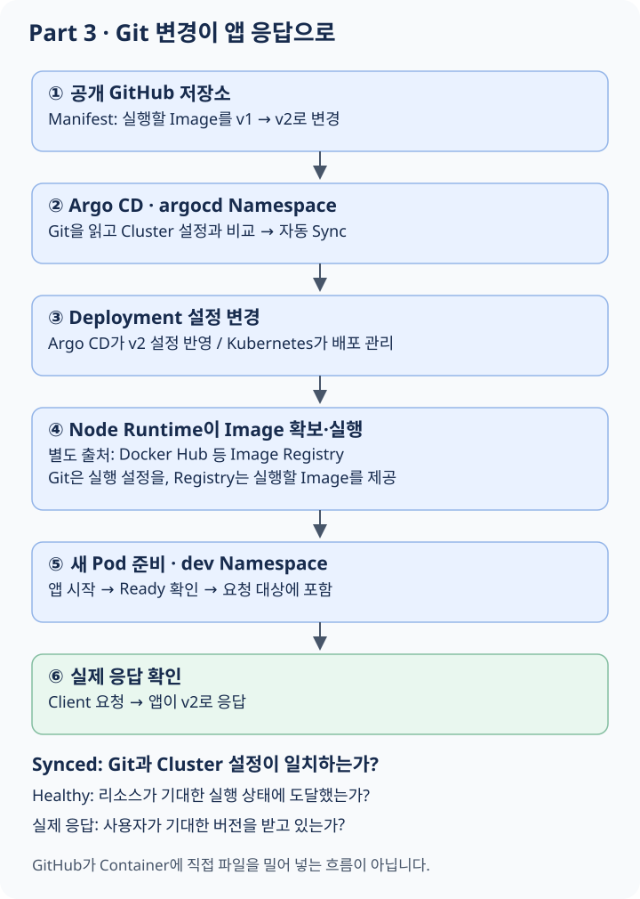

# Part 3: Git이 배포의 기준이 되는 과정

이번 Part의 질문은 **“누군가 직접 명령하지 않아도 Git에 적힌 상태로 앱을 유지할 수 있을까?”**입니다. Part 2의 Pod, Deployment, Service를 그대로 사용하면서 배포 설정을 관리하는 방법을 바꿉니다.

## 이 과제의 요구사항으로 무엇을 배울까?

과제는 **Vagrant 없이 Docker와 K3d로 Cluster를 만들고, 공개 GitHub 저장소의 변경을 Argo CD가 자동 배포하도록 구성하라**고 요구합니다. 앱은 v1과 v2를 구분할 수 있어야 합니다.

```text
내 PC
└── 실습 VM
    └── Docker
        └── K3d가 만든 Node Container들
            └── K3s Cluster
                ├── argocd Namespace -> Argo CD 구성요소
                └── dev Namespace -> Pod -> Container -> 앱

외부 GitHub 저장소 -> Argo CD가 설정 확인 -> 앱 배포 상태 변경
```

이 그림은 Node들이 Cluster를 이루고 그 Cluster가 앱을 관리하는 관계입니다. 모든 앱이 별도의 “Cluster Container” 하나 안에 들어간다는 뜻은 아닙니다.

| 요구사항 | 이 요구를 통해 배우는 것 |
|---|---|
| K3d와 Docker 사용 | Node를 실행하는 환경과 Node가 관리하는 앱의 실행 환경을 구분한다 |
| Namespace 분리 | 같은 Cluster 안에서도 관리 범위와 이름 공간을 나눌 수 있다 |
| 공개 GitHub에 설정 보관 | 실행할 상태의 기준과 변경 이력을 Cluster 밖에 남길 수 있다 |
| Argo CD 자동 배포 | Git에 선언한 상태와 실제 리소스 상태를 자동으로 맞출 수 있다 |
| v1에서 v2로 변경 후 응답 확인 | 파일 수정, 배포 반영, 앱 실행, 사용자 응답은 각각 다른 단계다 |

이 Part를 읽고 나면 **“Git의 한 줄이 바뀐 뒤 누가 어떤 일을 해서 PC 안의 앱 응답이 달라지는지”** 설명할 수 있는 것이 목표입니다.

## 1. 수동으로 잘 배포했는데 왜 바꿔야 할까?

사람이 직접 Cluster 설정을 바꾸면 지금 돌아가는 버전이 무엇인지, 누가 어떤 이유로 바꿨는지, 다른 환경에서 무엇을 재현해야 하는지 추적하기 어려워질 수 있습니다.

원하는 배포 상태를 파일로 적고 Git에 저장하면 변경 이력이 남습니다. 그런데 Git 파일만 바뀌었다고 실행 중인 앱이 저절로 바뀌지는 않습니다.

```text
Git: v2를 실행하고 싶다
Cluster: 아직 v1이 실행 중이다
```

두 상태를 비교하고 연결해 주는 역할이 필요합니다. 이 과제에서는 Argo CD가 그 역할을 맡습니다.

## 2. K3d는 K3s와 무엇이 다른가?

Part 1·2에서는 Vagrant로 만든 VM에 K3s를 설치했습니다. Part 3에서는 Docker Container를 Kubernetes Node의 실행 환경으로 사용합니다.

```text
Part 1·2: VM -> K3s Node -> 앱 Pod
Part 3:   Docker Container -> K3s Node -> 앱 Pod
               ▲
       K3d가 생성과 연결을 관리
```

**K3s**는 Kubernetes 배포판입니다. **K3d**는 K3s Node를 Docker Container로 쉽게 만들고 연결하는 도구입니다. 여기서 Docker는 앱 하나만 실행하기 위해 쓰는 것이 아니라, Node가 실행될 환경을 만드는 데 사용됩니다.

따라서 Docker가 보는 Node Container와 Kubernetes가 보는 앱 Pod는 서로 다른 층의 대상입니다. Container 안에서 Kubernetes가 또 Container를 관리한다는 말이 이상하게 들린다면 “Node를 실행하는 환경”과 “Node가 관리하는 앱”을 구분해 보세요.

## 3. Namespace는 왜 나눌까?

같은 Cluster에는 배포를 관리하는 Argo CD도 있고, 실제 사용자 앱도 있습니다. 이들을 이름과 관리 범위로 구분하기 위해 **Namespace**를 사용합니다.

```text
같은 Cluster
├── argocd Namespace: 배포를 관리하는 구성요소
└── dev Namespace:    우리가 배포할 앱
```

Namespace는 VM을 추가하는 것도, Node를 따로 만드는 것도 아닙니다. 같은 Node에 서로 다른 Namespace의 Pod가 함께 실행될 수 있습니다.

또한 Namespace를 나누기만 했다고 네트워크 통신이 자동 차단되지는 않습니다. 이름의 범위, 접근 권한 정책, 네트워크 격리는 서로 연결되지만 별도로 생각해야 하는 문제입니다.

## 4. Git Repository와 Image Registry

두 저장소를 먼저 구분해야 합니다.

| 위치 | 들어가는 것 | 가져가는 쪽 |
|---|---|---|
| GitHub Repository | 어떤 Image를 어떻게 실행할지 적은 설정 파일 | Argo CD |
| Docker Hub Registry | 실행할 앱의 Image | Node의 Container Runtime |

```text
GitHub의 YAML: wil42/playground:v2를 실행하라
                         │
                         ▼
Cluster의 배포 설정 변경
                         │
                         ▼
Node가 Registry에서 v2 Image를 가져와 실행
```

**Manifest**는 Kubernetes 리소스의 원하는 상태를 적은 문서입니다. 보통 YAML 형식으로 작성합니다. YAML은 들여쓰기로 데이터의 관계를 표현하는 파일 형식이며, 그것 자체가 앱 프로그램은 아닙니다.

Argo CD가 Git에 있는 앱 소스 코드를 자동으로 Image로 만드는 것은 아닙니다. 직접 만든 앱이라면 Image 빌드와 Registry 등록이 먼저 필요합니다.

## 5. v1과 v2는 무엇을 바꾸는가?

`wil42/playground:v1`에서 `v1`은 Image의 Tag입니다. `v2`는 다른 버전을 가리키도록 준비한 Tag입니다.

```text
v1 Image -> v1이라고 응답하는 앱
v2 Image -> v2라고 응답하는 앱
```

버전 변경은 실행 중인 Container 안에 들어가 파일을 손으로 고치는 방식이 아닙니다. 새 Image를 사용하는 Pod로 배포 상태를 전환합니다.

Tag 이름만 다르고 Image 내용이 같다면 사용자가 차이를 확인하기 어렵습니다. 과제에서는 두 버전을 구분할 수 있어야 합니다. 또한 Tag는 변경 가능한 이름표이므로 실제 어떤 Image를 가리키는지도 관리해야 합니다.

## 6. GitOps와 Source of Truth

**GitOps**는 Git에 선언한 상태를 기준으로 실행 환경을 관리하는 방식입니다. **Source of Truth**는 “어떤 상태가 맞는지 판단하는 기준”을 뜻합니다.

```text
사람이 원하는 변경을 Git에 기록
    -> 변경 이력이 남음
    -> 배포 관리 도구가 차이를 감지
    -> Cluster 상태를 Git에 맞춤
```

Cluster의 상태가 Git과 다르면 어느 쪽을 기준으로 맞출지 정해야 합니다. 이 흐름에서는 Git에 적힌 상태를 기준으로 삼습니다. 실제 앱 상태를 관찰하지 않아도 된다는 뜻은 아닙니다.

## 7. Argo CD는 무엇과 무엇을 비교할까?

**Desired State**는 Git Manifest에 선언한 원하는 상태입니다. **Actual State**는 Cluster API를 통해 확인하는 실제 리소스 상태입니다.

```text
Desired: Deployment Image = v2
Actual:  Deployment Image = v1
                    │
                    ▼
                차이 발견
                    │
                    ▼
        동기화: Deployment를 v2로 변경
```

동기화를 **Sync**라고 부릅니다. 수동 Sync는 사람이 반영을 시작하고, 자동 Sync는 정책에 따라 감지한 차이를 자동으로 반영합니다. 과제는 자동 배포를 요구하므로 자동 Sync가 필요합니다.

이 과정은 push 순간에 항상 즉시 끝나는 것이 아닙니다. Git 변경을 확인하는 주기, 다운로드, Pod 시작 시간이 있습니다. GitHub가 실행 중인 Container에 직접 파일을 밀어 넣는 방식도 아닙니다.

## 8. Application: 어떤 Git을 어디에 배포할까?

Argo CD에서 **Application**은 “어디의 설정을 어느 Cluster에 반영할지” 연결하는 관리 리소스입니다. 일반적인 말인 웹 Application과 구분해서 읽어야 합니다.

| 질문 | Application에 기록할 정보 |
|---|---|
| 어디의 파일을 읽을까? | Git Repository URL |
| 어느 버전을 따라갈까? | Branch, Tag 또는 commit |
| 어떤 디렉터리가 앱 설정일까? | 저장소 내부 Path |
| 어디에 배포할까? | 대상 Cluster와 Namespace |
| 언제 반영할까? | Sync 정책 |

```text
Source: GitHub / main / apps/playground
    -> Argo CD Application
    -> Destination: 현재 Cluster / dev
```

Git에 파일이 있어도 Path가 틀리면 원하는 Manifest를 읽지 못합니다. 다른 브랜치를 추적하면 main의 변경이 반영되지 않을 수 있습니다. “설정이 존재한다”와 “올바른 설정을 따라간다”를 구분해야 합니다.

## 9. Argo CD와 Kubernetes의 역할 분담

두 시스템 모두 상태를 맞추지만 비교하는 대상이 다릅니다.

```text
Argo CD:
Git의 Manifest <-> Cluster 리소스 설정

Kubernetes:
리소스의 원하는 상태 <-> 실제 Pod 실행 상태
```

Argo CD가 Deployment의 Image를 v2로 바꾸면, Kubernetes의 Deployment 관련 관리 기능이 새 ReplicaSet과 Pod를 관리합니다. Node의 Runtime이 Image를 가져와 실행하고, 준비된 Pod가 Service 대상에 들어갑니다.

Argo CD가 직접 각 Container 프로세스에 접속해서 버전 파일을 고치는 것이 아닙니다. 각 단계의 책임을 나누었기 때문에 어디서 멈췄는지도 구분할 수 있습니다.

## 10. v1에서 v2까지 머릿속으로 따라가기

**먼저 예상해 보기:** Git도 v2이고 Argo CD가 Synced라면 사용자도 반드시 v2 응답을 받고 있을까요?

<figure class="learning-diagram" markdown="1">
<div class="diagram-scroll" tabindex="0" role="region" aria-label="가로로 스크롤할 수 있는 학습 그림" markdown="1">

[](../../assets/diagrams/part3-gitops.svg)

</div>
<figcaption>Argo CD는 설정을 동기화하고, Kubernetes와 Runtime은 앱 실행을 관리합니다. 그림을 누르면 원본을 크게 볼 수 있습니다.</figcaption>
</figure>

<details class="learning-check">
<summary>생각한 뒤 해설 보기</summary>
<p>그렇다고 단정할 수 없습니다. 설정은 반영됐어도 Image 다운로드나 앱 시작이 실패할 수 있습니다. Pod의 준비 상태와 실제 응답까지 확인해야 합니다. Git의 설정, Cluster의 설정, 실행 결과는 각각 확인할 대상입니다.</p>
</details>

이 과정에서 “Git에는 v2가 보인다”는 첫 부분만 확인한 것입니다. 실제 앱 응답까지 확인해야 변경의 결과를 알 수 있습니다.

## 11. Synced와 Healthy는 다른 질문이다

| 상태 | 의미 |
|---|---|
| Synced | 추적하는 Git 설정과 Cluster 설정이 일치하는가? |
| OutOfSync | 두 설정 사이에 차이가 있는가? |
| Healthy | 리소스가 기대하는 실행 상태에 도달했는가? |

Git도 v2이고 Deployment도 v2이면 설정은 맞을 수 있습니다. 하지만 Image를 내려받지 못하면 Pod는 실행되지 못합니다. 따라서 Synced라는 표시만으로 앱이 정상이라는 결론을 내릴 수 없습니다.

Healthy도 모든 업무 기능의 정확성을 증명하는 것은 아닙니다. 과제에서는 마지막으로 실제 응답이 v1인지 v2인지 확인해야 합니다.

## 12. 수동 변경과 삭제는 어떻게 처리할까?

자동 Sync와 함께 자주 보이는 정책이 두 가지 있습니다.

**Self-heal**은 누군가 Cluster를 수동으로 바꿔 Git과 달라졌을 때 Git 상태로 되돌리는 정책입니다. **Prune**은 Git에서 제거한 관리 리소스를 Cluster에서도 삭제하는 정책입니다.

```text
Git v2 / Cluster를 사람이 v1로 변경 -> Self-heal의 대상
Git에서 Service 삭제 / Cluster에는 남음 -> Prune의 대상
```

자동 Sync를 켠다는 것과 이 두 정책을 켠다는 것은 별도 선택입니다. 무엇을 자동화하는지 이해해야 예상치 못한 복구나 삭제를 해석할 수 있습니다. [Argo CD 자동 동기화 정책](https://argo-cd.readthedocs.io/en/stable/user-guide/auto_sync/)

## 13. 관리 UI 접속과 앱 접속은 다르다

Argo CD 화면이 열린다는 것은 관리 프로그램에 접속했다는 뜻입니다. 사용자 앱까지 연결된다는 뜻은 아닙니다.

```text
관리 경로: Browser -> Argo CD UI
사용 경로: Client  -> playground 앱
```

**port-forward**는 개발·확인 목적으로 로컬 포트를 Pod까지 임시 연결해 주는 방법입니다. 실행한 프로그램이 종료되거나 연결한 Pod가 교체되면 접속도 끊길 수 있습니다.

이때 localhost는 port-forward를 실행한 환경입니다. 실습 VM에서 연결을 열었는데 물리 Mac의 localhost를 찾아가면 다른 곳을 보고 있는 것입니다. Docker의 포트 공개, Ingress를 통한 접근, kubectl의 port-forward는 비슷하게 보여도 구성되는 경로가 다릅니다.

## 14. 과제 요구사항을 개념에 연결하기

기준: `inception_of_things.pdf` v4.0, 본문 12–15쪽.

| 요구사항 | 이해할 개념 |
|---|---|
| VM에서 Docker와 K3d 사용, Vagrant 없이 구성 | Node 실행 환경의 변경 |
| 필요한 도구를 설치할 Script | 재현 가능한 준비 과정 |
| Argo CD용 Namespace와 `dev` Namespace | 관리 프로그램과 앱의 범위 구분 |
| 팀원 login이 이름에 포함된 공개 GitHub 저장소 | 배포 설정의 공개된 기준 |
| v1·v2 앱, GitHub 변경으로 자동 업데이트 | GitOps와 실제 결과 검증 |

원문이 제공하는 `wil42/playground`는 8888 포트를 사용합니다. 직접 만든 앱을 쓴다면 공개 Docker Hub 저장소에 구분 가능한 v1·v2 Image를 준비해야 합니다.

원문은 continuous integration이라는 표현도 사용하지만, 여기서 Argo CD로 배우는 중심은 배포와 동기화(CD)입니다. 소스 코드 빌드·테스트 자동화(CI)는 별도 단계입니다. 설정과 실행 명령은 [구현 참고](implementation-reference.md)에 있습니다.

## 15. 이해를 확인하기

1. K3s와 K3d는 각각 어떤 역할인가?
2. Git Repository와 Image Registry에는 무엇이 저장되는가?
3. Argo CD와 Kubernetes는 각각 어떤 상태 차이를 줄이는가?
4. Git에 v2를 push했는데도 앱이 v1이라면 어느 단계를 확인할까?
5. Synced인데 Pod가 실행되지 않을 수 있는 이유는 무엇인가?
6. Argo CD UI가 열리는데 앱 접속이 실패하면 두 경로를 어떻게 나누어 볼까?

다음: [Bonus — Local GitLab](bonus.md)
